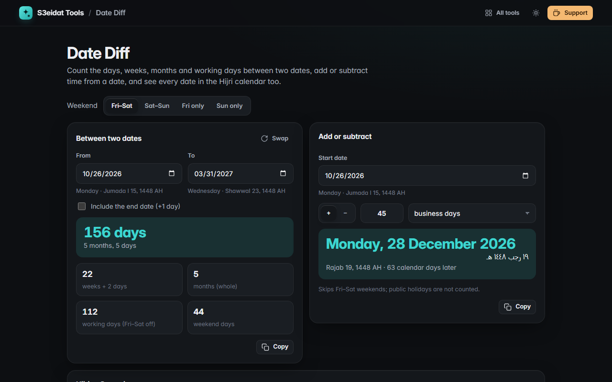

# Date Diff

> Days between dates, working days, add or subtract time, and Hijri dates. Free, private, and it runs entirely in your browser.

### ▶ [Open Date Diff](https://s3eidat.github.io/date-diff/)



## Features

- **Between two dates**: days, years-months-days, weeks, whole months, **working days** and weekend days
- Choose the **weekend**: Fri–Sat, Sat–Sun, Friday only or Sunday only
- Optionally **include the end date**; swap dates in one click
- **Add or subtract** days, business days, weeks, months or years (month-end safe: Jan 31 + 1 month = Feb 28/29)
- Every date is shown with its **weekday** and its **Hijri** date (Umm al-Qura), in English and Arabic
- **Hijri → Gregorian** converter for 1300–1600 AH
- Pure calendar arithmetic, so time zones and daylight saving never shift a day; copy any result

Working days skip weekends only, not public holidays. Hijri dates come from the Umm al-Qura calendar built into your browser; local moon-sighting can differ by a day.

## Privacy

Your dates never leave your device. There is no server, no account, no analytics.
The page ships with a strict Content-Security-Policy (`connect-src 'self'`), so the browser
itself blocks any attempt to send data anywhere.

## Run it yourself

It's plain HTML, CSS and JavaScript with no build step:

```bash
git clone https://github.com/s3eidat/date-diff
cd date-diff
python -m http.server 8000
```

Then open http://localhost:8000.

## Support

If this saved you time, **[buy me a coffee ☕](https://s3eidat.github.io/coffee/)**. It keeps every tool free.

---

Part of **[S3eidat Tools](https://s3eidat.github.io/)**: 100+ free, private tools that run in your browser. MIT licensed.
